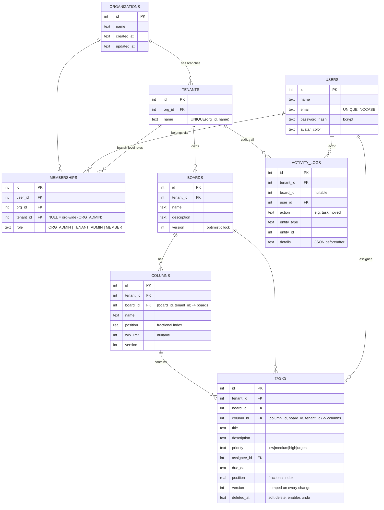

# Database schema / ER diagram

The real schema is in [`server/db/schema.sql`](../server/db/schema.sql) (SQLite).
The diagram below is Mermaid. GitHub and VS Code (with a Mermaid extension) draw it automatically.

## Why it looks like this

| Decision | Reason |
|---|---|
| `tenant_id` is on **every** business table, even when it could be found through the parent | Every query can filter with `WHERE tenant_id = ?` directly, with no joins needed. It also makes a later move to Postgres Row-Level Security or sharding by tenant simple. |
| **Composite foreign keys**, e.g. `tasks(column_id, board_id, tenant_id) → columns(id, board_id, tenant_id)` | The **database** refuses a task that points to a column in another branch or board, even if the app code had a bug. That is my second line of defence. |
| `memberships(tenant_id, org_id) → tenants(id, org_id)` | A branch membership can't point to a branch of a *different* organization. |
| `CHECK` on memberships: ORG_ADMIN ⇔ `tenant_id IS NULL` | One row per role scope, so the roles can't get mixed up. |
| Partial unique indexes on memberships | SQLite treats NULLs in UNIQUE as distinct, so I used one index for org-level rows and one for branch rows. |
| `position REAL` | Fractional indexing: moving a card updates **one** row. |
| `version INTEGER` | Optimistic locking: `UPDATE … WHERE version = ?`. |
| `deleted_at` (soft delete) | "Undo delete" just clears it. The history stays in the activity log. |
| Index `tasks(tenant_id, column_id, position) WHERE deleted_at IS NULL` | Exactly the "cards of a column in order" query. It's a partial index, so deleted cards don't bloat it. |
| Index `activity_logs(tenant_id, id DESC)` | The activity feed is "newest N for a tenant", paged with `beforeId`. |
